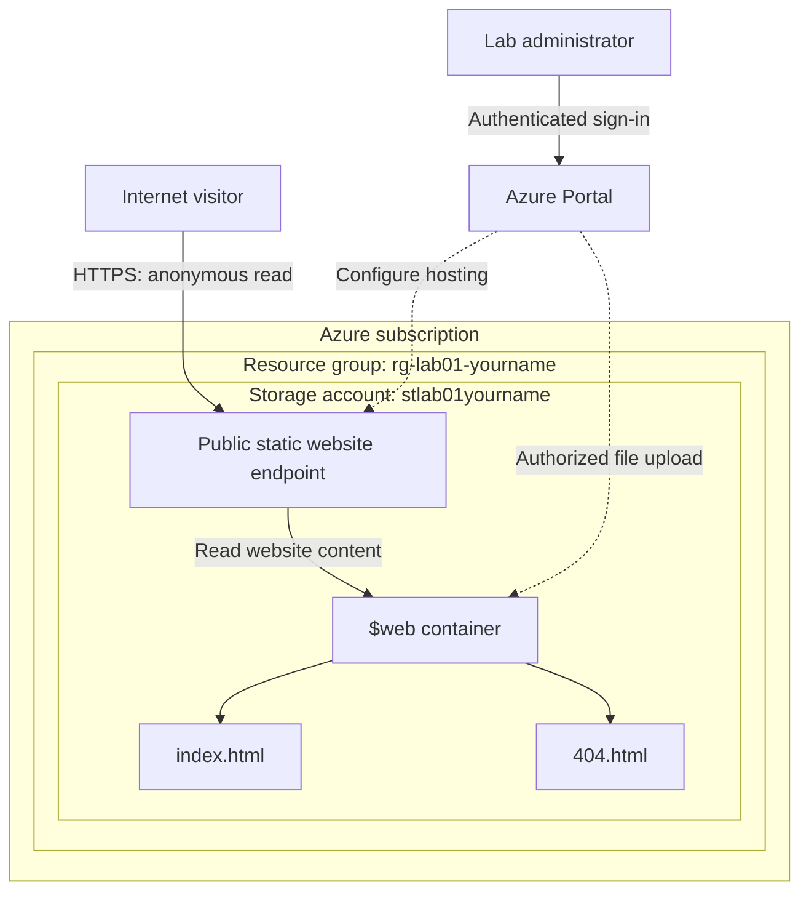

# Lab 01: Hosting Your First Static Website in Azure

Deploy a public static website using **Azure Blob Storage**, without provisioning a virtual machine or maintaining a web server.

| Lab detail | Value |
| --- | --- |
| Difficulty | Beginner |
| Estimated time | 30 minutes |
| Deployment method | Azure Portal |
| Services | Azure Resource Groups, Azure Storage, Blob Storage |

> This README is a reproducible lab guide. Validation steps describe expected results; screenshots and a completed deployment are not included.

## Overview

This lab introduces managed cloud hosting: you create the website files, while Azure operates the underlying infrastructure. Azure Storage provides a managed storage service with a static website feature, enabling a serverless hosting approach for HTML, CSS, JavaScript, and images.

By completing the lab, you will learn to:

- Organize Azure resources in a dedicated resource group.
- Create a storage account using a consistent naming convention.
- Enable static website hosting and publish content to the `$web` container.
- Verify the home page and a custom error page.
- Distinguish anonymous website access from authenticated content management.
- Remove lab resources when finished.

**Scope:** Azure Storage static website hosting. This lab does not use the separate **Azure Static Web Apps** service, a virtual machine, a database, or server-side application code.

## Architecture



**Request flow:** A visitor opens the HTTPS primary endpoint. Azure serves `index.html` from `$web` for the site root, or the configured `404.html` when the requested page does not exist.

**Security boundary:** Visitors read published content anonymously. The administrator configures the resource and uploads files using authorized access. The resource group is an organizational boundary, not a network firewall.

## Prerequisites

- [ ] An active Azure subscription. A free account can be used, subject to its limits and available credit.
- [ ] Permission to create a resource group and storage account, configure hosting, and upload blobs.
- [ ] A browser and a plain-text editor such as VS Code or Notepad.
- [ ] Basic familiarity with Azure subscriptions and resource groups. Complete the Week 1 video modules if following the original course.

For Microsoft Entra-based portal uploads, use an appropriate blob data role, such as **Storage Blob Data Contributor**, along with permission to navigate to the account. Resource-management permissions and blob-data permissions are separate; see the [portal access guidance](https://learn.microsoft.com/en-us/azure/storage/blobs/assign-azure-role-data-access).

## Lab configuration

Replace `yourname` with your own lowercase name or short identifier. Do not include brackets in actual resource names.

| Setting | Value | Example |
| --- | --- | --- |
| Resource group | `rg-lab01-yourname` | `rg-lab01-rick` |
| Region | East US | East US |
| Storage account | `stlab01yourname` | `stlab01rick42` |
| Account type | General-purpose v2 | StorageV2 |
| Performance | Standard | Standard |
| Redundancy | Locally-redundant storage | LRS |
| Index document | `index.html` | Exact lowercase filename |
| Error document | `404.html` | Exact lowercase filename |

Storage account names must be globally unique, contain only lowercase letters and numbers, and be **3–24 characters** long. Add a short numeric suffix if your preferred name is unavailable.

## Deployment steps

### 1. Create the resource group

**Where:** [Azure Portal](https://portal.azure.com/)

1. Sign in and search for **Resource groups**.
2. Select **Create**.
3. Choose your subscription.
4. Enter `rg-lab01-yourname` as the resource group name.
5. Choose **East US** as the region.
6. Select **Review + create**, then **Create**.

**Expected result:** The new resource group appears in the resource group list.

### 2. Create the storage account

**Where:** Azure Portal → **Storage accounts** → **Create**

1. Select the same subscription and the resource group created above.
2. Enter your unique storage account name.
3. Choose **East US**, **Standard** performance, and **Locally-redundant storage (LRS)**.
4. Use a standard general-purpose v2 account. If the portal asks for a primary service, select **Azure Blob Storage or Azure Data Lake Storage Gen2**.
5. For this public website lab, allow public network access from all networks. Use a dedicated lab account containing only content intended for public viewing.
6. Keep **Secure transfer required** enabled and the minimum TLS version at **1.2** or higher where supported.
7. Keep **Allow Blob anonymous access** disabled. The static website endpoint does not require enabling anonymous access on the Blob service.
8. Select **Review + create**, check the configuration, then select **Create**.
9. Wait for deployment to finish and select **Go to resource**.

**Expected result:** The storage account overview is available with no deployment errors.

> Portal labels can change. Use the storage account menu search to locate a setting when its position differs.

### 3. Enable static website hosting

**Where:** Your storage account → **Static website**

1. Find **Static website** under **Data management**, or use **Overview → Capabilities → Static website**.
2. Select **Enabled**.
3. Set **Index document name** to `index.html`.
4. Set **Error document path** to `404.html`.
5. Select **Save**.
6. Copy the displayed **Primary endpoint**.

Example format only:

```text
https://stlab01yourname.z13.web.core.windows.net/
```

**Use the exact URL Azure displays.** The zone component, such as `z13`, can differ. Do not construct the URL manually or substitute a `blob.core.windows.net` address.

**Expected result:** Hosting is enabled and Azure creates a container named `$web`.

### 4. Create the website files

**Where:** Your local computer, using a plain-text editor.

Create a folder for the website. Save both files below in that folder. Replace `[Your Name]` with the name you want displayed publicly.

#### `index.html`

```html
<!DOCTYPE html>
<html lang="en">
<head>
  <meta charset="UTF-8">
  <meta name="viewport" content="width=device-width, initial-scale=1.0">
  <title>My First Cloud Site</title>
  <style>
    body {
      font-family: Arial, sans-serif;
      text-align: center;
      margin: 0;
      padding: 64px 24px;
      background-color: #f0f0f0;
      color: #222;
    }
    main { max-width: 720px; margin: auto; }
    h1 { color: #0078d4; }
  </style>
</head>
<body>
  <main>
    <h1>Hello from the Cloud!</h1>
    <p>This site is hosted on Azure Blob Storage.</p>
    <p>Deployed by: [Your Name]</p>
  </main>
</body>
</html>
```

#### `404.html`

```html
<!DOCTYPE html>
<html lang="en">
<head>
  <meta charset="UTF-8">
  <meta name="viewport" content="width=device-width, initial-scale=1.0">
  <title>404 | Page Not Found</title>
</head>
<body>
  <main>
    <h1>404 — Page not found</h1>
    <p>The page you requested does not exist.</p>
    <a href="/">Return to the home page</a>
  </main>
</body>
</html>
```

On Windows, select **Save as type: All Files** in Notepad and use UTF-8 encoding. Enable **File name extensions** in File Explorer to confirm the files are not named `index.html.txt` or `404.html.txt`.

**Expected result:** Opening `index.html` locally displays the welcome message. Local viewing checks the HTML only; Azure hosting is verified later.

### 5. Upload the content

**Where:** Storage account → **Data storage → Containers → `$web`**

1. Open `$web` and select **Upload**.
2. Select `index.html` and `404.html`.
3. Upload both files to the **root of the container**, without a parent folder.
4. Open each uploaded blob's properties and verify **Content-Type** is `text/html`. Correct it if necessary.
5. For future updates, upload the revised file with overwrite enabled.

**Expected result:** Both filenames appear directly inside `$web`.

## Validation

Run these checks against the **Primary endpoint** copied from Azure:

| Check | Action | Expected result |
| --- | --- | --- |
| Home page | Open the endpoint in a new browser tab | “Hello from the Cloud!” and your chosen display name appear |
| Direct document | Append `/index.html` to the endpoint host | The same home page loads |
| Custom error page | Append `/missing-page.html` | Your custom “404 — Page not found” page appears |
| Anonymous access | Open the endpoint in a private/incognito window | The site loads without an Azure sign-in |
| HTTPS | Inspect the browser address | The site uses `https://` |

For HTTP-level verification, open browser developer tools, select **Network**, and reload the page. The home page should return **200**; a missing document should return **404** while displaying your custom error page.

### Optional portfolio evidence

After completing the lab, capture the following for your repository:

- The static website configuration and primary endpoint.
- The `$web` container showing both uploaded files.
- The working home page and custom error page in the browser.

Review screenshots before publishing. Remove account identifiers, email addresses, access keys, tokens, and unrelated resources. Add evidence only after performing the corresponding checks.

## Security considerations

| Consideration | Meaning for this lab |
| --- | --- |
| Public content | Files exposed through the static website endpoint are anonymously readable. Publish only intentionally public material. |
| Separate access controls | A private `$web` container access level or disabled Blob anonymous access does **not** make the static website endpoint private. |
| Upload permissions | Public read access does not grant write access. Limit administrative and blob upload permissions to the people who need them. |
| Transport | Use the provided HTTPS endpoint to protect traffic in transit. |
| Secrets | Never place passwords, storage keys, connection strings, or SAS tokens in HTML, JavaScript, screenshots, or Git commits. |
| Hosting limits | This endpoint does not provide built-in user authentication or server-side application execution. |

This is a beginner public-hosting design. An application requiring sign-in, private content, or additional edge protection needs a different or extended architecture.

## Troubleshooting

| Symptom | Likely cause | Resolution |
| --- | --- | --- |
| Home page returns 404 | Filename mismatch or wrong upload location | Confirm `index.html` is lowercase, at the root of `$web`, and matches the configured index document exactly. |
| Site URL fails | Wrong endpoint | Copy the **Primary endpoint** from Static website. Do not use the blob URL or guess the zone value. |
| Custom error page is missing | `404.html` was not uploaded or configured | Check both the file and the Error document path. |
| File downloads instead of displaying | Incorrect content type | Set the uploaded HTML blob's Content-Type to `text/html`. |
| Storage account name is unavailable | Name already exists globally | Add a short numeric suffix while keeping the name within 24 characters. |
| Upload is denied | Insufficient data permissions or network restrictions | Check the portal authentication method, blob data role, and storage network settings. Allow time for new role assignments to propagate. |
| Website is inaccessible from another network | Public network access is restricted | Review account networking against the public-hosting settings for this lab and any organizational policies. |
| Old content still appears | Cached page or upload did not overwrite | Confirm the new blob was uploaded, then perform a hard refresh or use a private window. |
| Resource creation is blocked | Subscription policy or regional restrictions | Read the deployment error and use a policy-approved region or configuration. Record any deviation from this guide. |

## Cost and cleanup

Static website hosting can incur charges for stored data, operations, and outbound data transfer. Free-account eligibility does not guarantee that every resource or usage level is free. LRS keeps this lab simple; review the [Azure Blob Storage pricing page](https://azure.microsoft.com/en-us/pricing/details/storage/blobs/) for your subscription and region.

When finished:

1. Save any website files and portfolio evidence you want to keep.
2. In Azure Portal, open **Resource groups**.
3. Select `rg-lab01-yourname`.
4. Inspect the resource list and confirm that the group contains only disposable lab resources.
5. Select **Delete resource group**.
6. Enter the exact resource group name and confirm deletion.
7. Wait for deletion to finish, then refresh the resource group list to verify removal.

> Deleting a resource group deletes **all resources inside it**, including the storage account and uploaded website files. The site will no longer be available after cleanup.

## Completion checklist

- [ ] Created a dedicated resource group and storage account.
- [ ] Enabled static website hosting.
- [ ] Uploaded `index.html` and `404.html` to `$web`.
- [ ] Verified home page, missing-page behavior, HTTPS, and anonymous access.
- [ ] Reviewed the public-access model and kept secrets out of published content.
- [ ] Saved any desired evidence and removed disposable resources.

## References

Microsoft documentation:

- [Static website hosting in Azure Storage](https://learn.microsoft.com/en-us/azure/storage/blobs/storage-blob-static-website)
- [Enable hosting and upload content](https://learn.microsoft.com/en-us/azure/storage/blobs/storage-blob-static-website-how-to)
- [Create an Azure storage account](https://learn.microsoft.com/en-us/azure/storage/common/storage-account-create)
- [Static website hosting FAQ](https://learn.microsoft.com/en-us/azure/storage/blobs/static-website-hosting-faq)
- [Assign an Azure role for blob data access](https://learn.microsoft.com/en-us/azure/storage/blobs/assign-azure-role-data-access)
